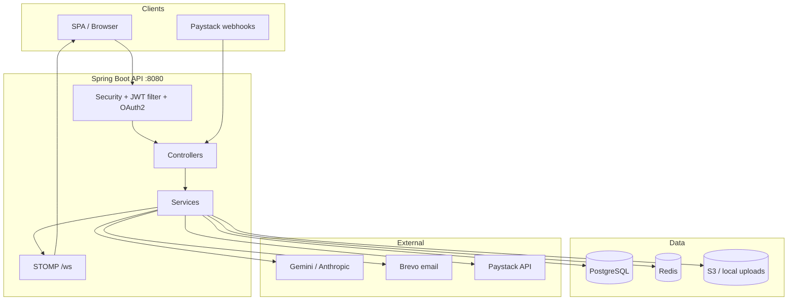
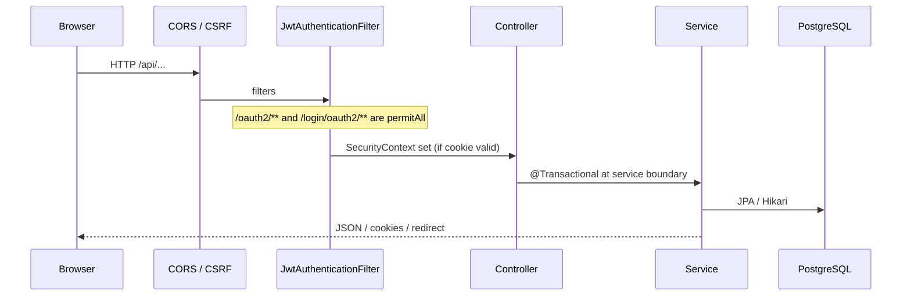
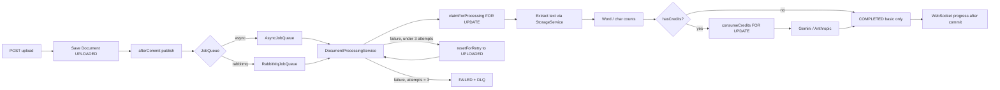
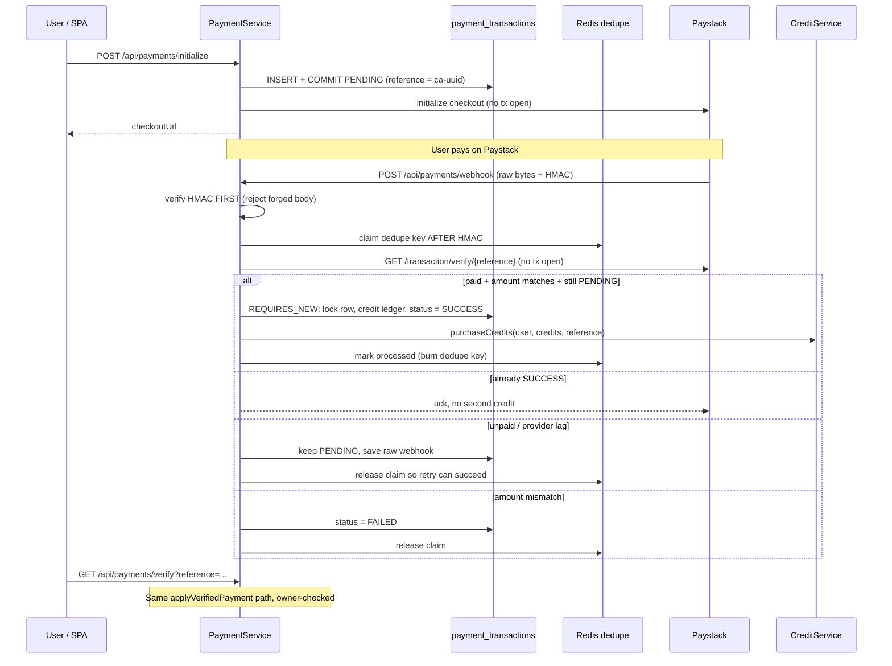
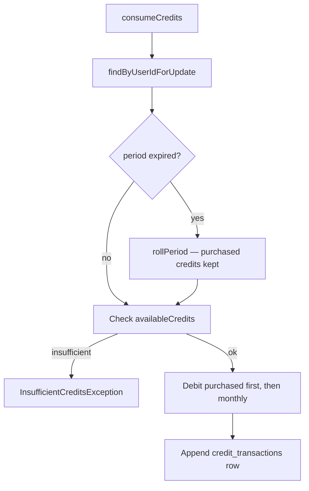
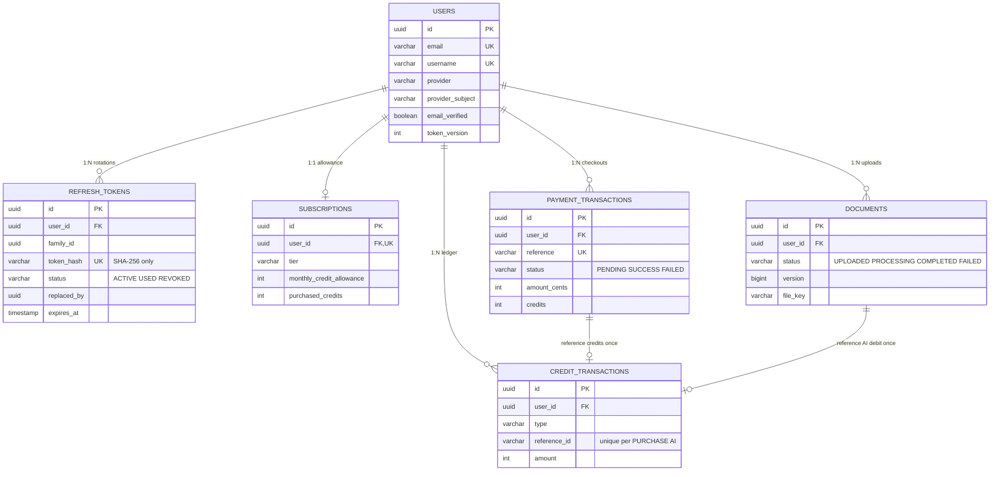
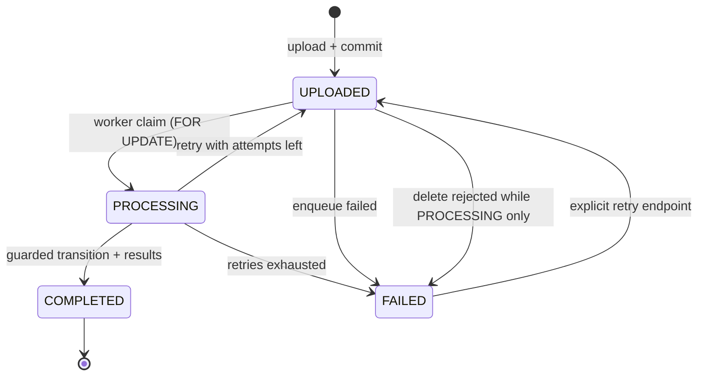
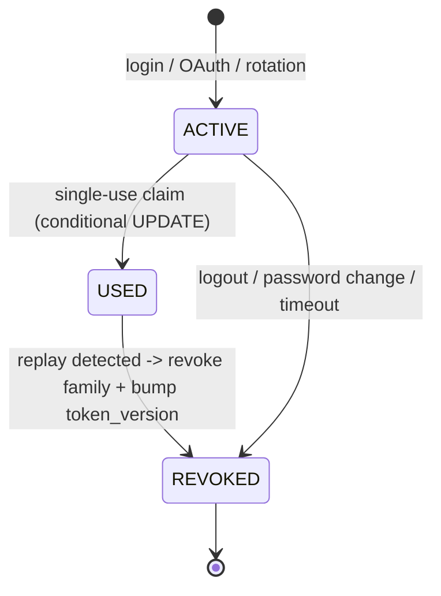

# Content Analytics — Backend

## What this project is

**Content Analytics** is a freemium SaaS for people who work with documents —
writers, researchers, and small teams who need more than a file store. Users
upload PDFs and Office docs, get structured AI analysis (summary, key topics,
sentiment), and track usage against a monthly credit allowance they can top up.

This repository is the **backend API** that owns identity, billing, storage,
analysis jobs, and the credit ledger. The SPA is a separate frontend that talks
to this API over HTTPS (cookies + CSRF) and receives live job progress over
WebSocket.

In short: authenticate → upload → analyse (async, credit-gated) → pay for more
credits when the free tier runs out — with money moving only through a verified
Paystack webhook, never from a browser callback alone.

> **Frontend:** separate repository.
> <!-- FRONTEND-REPO-PLACEHOLDER: replace the URL below with the real repo when created. -->
> **Frontend repo:** `https://github.com/<org-or-user>/<frontend-repo>` _(placeholder — update when the repo exists)_
>
> Backend ↔ frontend contracts:
> - `NEXT_PUBLIC_API_URL` → this API origin
> - `GET /api/auth/providers`
> - `/auth/callback?status=...&reason=...` redirect (see [`docs/AUTHENTICATION.md`](docs/AUTHENTICATION.md))

## Table of contents

1. [What this project is](#what-this-project-is)
2. [Architecture](#architecture)
3. [Stack](#stack)
4. [Quickstart](#quickstart)
5. [Docker](#docker)
6. [Configuration](#configuration)
7. [Authentication](#authentication)
8. [Payments and credits](#payments-and-credits)
9. [Concurrency and idempotency](#concurrency-and-idempotency)
10. [API overview](#api-overview)
11. [Database and migrations](#database-and-migrations)
12. [Tests](#tests)
13. [Continuous integration](#continuous-integration)
14. [Deployment](#deployment)
15. [Repository map](#repository-map)
16. [Further docs](#further-docs)

---

## Architecture

Monolith layout: **controllers → services → JPA repositories → PostgreSQL**.
Redis backs cache, login lockout, idempotency keys, and atomic rate-limit
counters. Document analysis runs async (`@Async` or RabbitMQ). Auth is one JWT
cookie path for every caller; Google OAuth only provisions into the same `users`
table.



### Request lifecycle



### Document analysis pipeline



More module detail: [`docs/ARCHITECTURE.md`](docs/ARCHITECTURE.md).

---

## Stack

| Layer | Choice |
|---|---|
| Runtime | Java 21, Spring Boot 4.0.6 (Maven `mvnw`) |
| Auth | Spring Security + JWT in HttpOnly cookies; `spring-boot-starter-oauth2-client` for Google (authorization-code only) |
| Data | Spring Data JPA + Flyway, PostgreSQL (local / Supabase prod) |
| Cache / realtime | Redis, STOMP WebSocket (`/ws`) |
| Storage | S3-compatible SDK (Supabase Storage prod), local filesystem for dev |
| AI | Google Gemini (default), Anthropic optional, `none` to disable |
| Payments | Paystack (test → live via key swap) |
| Email | Brevo (verification + password-reset) |
| Observability | Actuator (health / info / prometheus); JaCoCo report (check gate not enforced yet) |

---

## Quickstart

Prerequisites: JDK 21, Maven wrapper, PostgreSQL 15+, Redis.

```bash
# Local values live in src/main/resources/application.properties
./mvnw spring-boot:run

# Prod profile (Render: Supabase + Upstash)
SPRING_PROFILES_ACTIVE=prod ./mvnw spring-boot:run
```

API: `http://localhost:8080`.

---

## Docker

Multi-stage image (Maven/JDK 21 build → slim JRE 21, unprivileged user, healthcheck).

| Already run Postgres/Redis/RabbitMQ locally | Fresh machine |
|---|---|
| `docker compose -f docker-compose.app.yml up --build` | `docker compose up --build` |

- **`docker-compose.app.yml`** — app only; reaches host services via `host.docker.internal`.
- **`docker-compose.yml`** — app + Postgres + Redis + RabbitMQ (avoid if host ports are taken).

API on `http://localhost:8080`. Uploads persist in a named `uploads` volume.

---

## Configuration

| File | Role |
|---|---|
| `application.properties` | Local Postgres/Redis, dev JWT, CORS/`FRONTEND_URL`, optional Google/Gemini/Brevo/Paystack |
| `application-prod.properties` | Secrets from Render env vars only |
| `application-test.properties` | In-memory H2, `create-drop`, no external deps |

Never hardcode production secrets. Local keys stay out of git when real.

---

## Authentication

Password + optional Google authorization-code flow. One JWT cookie pair for all sessions.

```mermaid
flowchart TD
  Start[Sign-in] --> Local{Password?}
  Local -->|yes| Login[POST /api/auth/login]
  Local -->|Google| OAuth[GET /oauth2/authorization/google]
  OAuth --> Google[Google consent]
  Google --> Callback[GET /login/oauth2/code/google]
  Callback --> Prov[OAuthAccountProvisioner]
  Prov --> Find[Find by Google sub]
  Prov --> Link[Link verified email to LOCAL]
  Prov --> Create[Create passwordless GOOGLE user]
  Login --> Tokens[AuthService.issueTokens]
  Find --> Tokens
  Link --> Tokens
  Create --> Tokens
  Tokens --> Cookies[HttpOnly access + refresh cookies]
  Cookies --> SPA[/auth/callback?status=success]
```

- **Start:** `GET /oauth2/authorization/google`
- **Success:** `302 <FRONTEND_URL>/auth/callback?status=success`
- **Failure:** `302 ...?status=error&reason=<code>`  
  (`access_denied | link_conflict | email_unverified | state_mismatch | client_not_configured | error`)
- **Capability:** `GET /api/auth/providers` → `{"google": true|false}`

Account rules: unverified Google emails rejected; first sign-in links by verified email or creates passwordless row; a row already linked to a *different* Google `sub` is never re-pointed (409).

Setup: [`docs/GOOGLE_OAUTH_SETUP.md`](docs/GOOGLE_OAUTH_SETUP.md).  
Design: [`docs/AUTHENTICATION.md`](docs/AUTHENTICATION.md).

---

## Payments and credits

Invariant: **credits move only when a PENDING `payment_transactions` row flips to SUCCESS** after HMAC verification and a server-side Paystack re-query. Browser callbacks never mint credits alone.



Credit packs (USD cents, Paystack `currency=USD`): 10 → 200 ($2.00), 50 → 800 ($8.00), 120 → 1_600 ($16.00).

Admin-only `POST /api/subscription/purchase-credits` seeds balances for demos/tests — not the real money path.

---

## Concurrency and idempotency

How money and credits stay consistent under load:

| Concern | Mechanism |
|---|---|
| Concurrent credit spend | `SubscriptionRepository.findByUserIdForUpdate` → `SELECT … FOR UPDATE` |
| Concurrent free-tier create | Unique `subscriptions.user_id` + catch `DataIntegrityViolationException` and re-read |
| Period rollover vs spend | Rollover under the same pessimistic lock in `consumeCredits` / `getOrCreateSubscription` |
| Payment double-delivery | Status guard (SUCCESS → no-op) + unique `payment_transactions.reference` |
| Checkout client retries | `@Idempotent` + Redis (`Idempotency-Key`) on initialize |
| Webhook retries | HMAC verified first; Redis claim taken afterwards and released on every non-crediting outcome; DB status guard is authoritative |
| Login abuse | Redis lockout (`LoginAttemptService`) + atomic Redis fixed-window counters on login/register |
| Refresh-token replay | Single-use conditional `UPDATE` in `refresh_tokens`; reuse revokes the whole family and bumps `token_version` |
| Token invalidation | `users.token_version` embedded in **both** access and refresh JWTs; the filter checks it against the DB on every request |
| Document jobs | `SELECT … FOR UPDATE` claim + guarded status transitions; duplicate deliveries are no-ops, retries are bounded |
| Optimistic conflicts | JPA `@Version` on subscription / payment / credit / user / document rows |
| External calls | Provider HTTP (Paystack), storage I/O and queue publishes happen **outside** DB transactions; commits are completed before consumers can observe the work |



---

## API overview

Base path `/api`. Auth cookies are HttpOnly; CSRF via `GET /api/auth/csrf`.

| Area | Endpoints |
|---|---|
| Auth | register, login, refresh, logout, verify-email, forgot/reset-password, csrf, **providers** |
| OAuth | `GET /oauth2/authorization/google`, `GET /login/oauth2/code/google` |
| Profile | GET/PUT profile, password change, avatar |
| Documents | upload / list / download / delete / analysis |
| Health metrics | CRUD + aggregates |
| Subscriptions | tier, ledger, admin purchase-credits |
| Payments | initialize, webhook, verify, history, status |
| Ops | `/actuator/health`, `/actuator/info`, `/actuator/prometheus` |

Full tables: [`docs/API.md`](docs/API.md).

---

## Database and migrations

Flyway (`spring.jpa.hibernate.ddl-auto=validate`) runs versioned SQL from
`src/main/resources/db/migration` on boot.

| Version | Purpose |
|---|---|
| V1–V10 | users, documents, health metrics, email/password tokens, profiles, avatars, password history, subscriptions/credits/audit, indexes |
| V11 | Google OAuth: `provider`, `provider_subject`, nullable `password`, unique `(provider, provider_subject)` |
| V12 | `payment_transactions` ledger (PENDING-first, unique `reference`) |
| V13 | Drop unused profile `company` / `job_title` |
| V14 | DB CHECK constraints (positive amounts, non-negative credits, period bounds) |
| V15 | JPA `@Version` columns + unique purchase / AI-analysis `reference_id` indexes |
| V16 | `refresh_tokens`: single-use rotation, family replay detection, hash-only storage |
| V17 | `documents.version` optimistic-lock column for guarded job transitions |
| V18 | `payment_transactions.amount_cents` - USD pricing (cents, not kobo) |

### Data model (core tables)



### Document status machine



### Refresh token lifecycle



---

## Tests

```bash
./mvnw test
```

Suite runs on H2 (`create-drop`), no network, injected `Clock` for deterministic
JWT expiry and billing periods.

Coverage highlights:

- **Google** — find/link/create, sub-mismatch refusal, providers flag, failure reasons
- **Payments** — signature, amount mismatch, sequential duplicate webhook
- **JWT** — round-trip, expiry boundary, wrong signature
- **Credits** — available balance, period rollover preserving purchased credits
- **Storage / AI / rate limit** — unit + integration slices

---

## Continuous integration

GitHub Actions: [`.github/workflows/ci.yml`](.github/workflows/ci.yml) — build + test on push/PR.

---

## Deployment

Prod profile (`SPRING_PROFILES_ACTIVE=prod`):

1. Supabase Postgres **transaction pooler** (`:6543`, keep `?prepareThreshold=0`)
2. Upstash Redis, Supabase Storage (S3 gateway; private bucket; downloads via API)
3. Render env vars from `application-prod.properties` (+ `GOOGLE_*`, `FRONTEND_URL`, `JWT_SECRET` 64+ bytes, Paystack keys)
4. Google redirect: `https://<backend-host>/login/oauth2/code/google`
5. Flyway on boot; health: `/actuator/health`

Runbook: [`docs/DEPLOYMENT.md`](docs/DEPLOYMENT.md).

---

## Repository map

```
src/main/java/com/contentanalytics/
  config/           Security, CORS, CSRF, WebSocket, RabbitMQ, Clock
  controller/       Auth, Profile, Document, Payment, Subscription, Health
  service/          Auth, Credits, Documents, Storage, AI, Idempotency, RateLimit
  service/payment/  PaymentService, PaystackProvider
  security/         JWT filter/provider, TokenSessionValidator, OAuth handlers
  aspect/           Idempotency + rate-limit annotations
  entity/           User, RefreshToken, Document, Subscription, PaymentTransaction, …
  repository/       JPA + pessimistic lock / conditional claim queries
  exception/        GlobalExceptionHandler + domain errors
src/main/resources/db/migration/   Flyway V1–V18
src/test/java/…                    H2 suite + opt-in real-Postgres migration test
```

---

## Further docs

| Doc | Contents |
|---|---|
| [`docs/AUTHENTICATION.md`](docs/AUTHENTICATION.md) | Password + Google, cookies, `/auth/callback` |
| [`docs/GOOGLE_OAUTH_SETUP.md`](docs/GOOGLE_OAUTH_SETUP.md) | Google Cloud Console checklist |
| [`docs/API.md`](docs/API.md) | Endpoint reference |
| [`docs/DEPLOYMENT.md`](docs/DEPLOYMENT.md) | Render + Supabase + Upstash |
| [`docs/DEVELOPMENT.md`](docs/DEVELOPMENT.md) | Local dev |
| [`docs/ARCHITECTURE.md`](docs/ARCHITECTURE.md) | Module overview |
