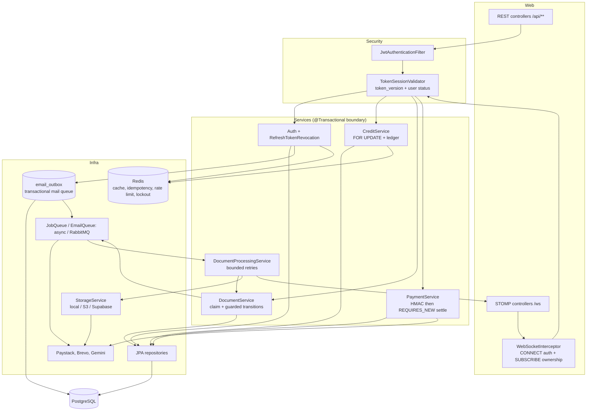
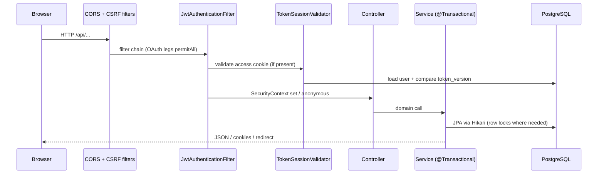
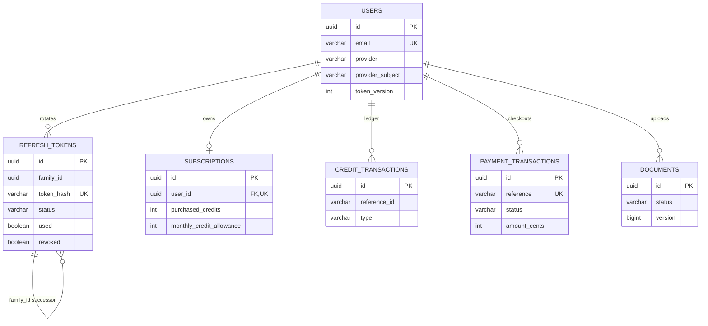
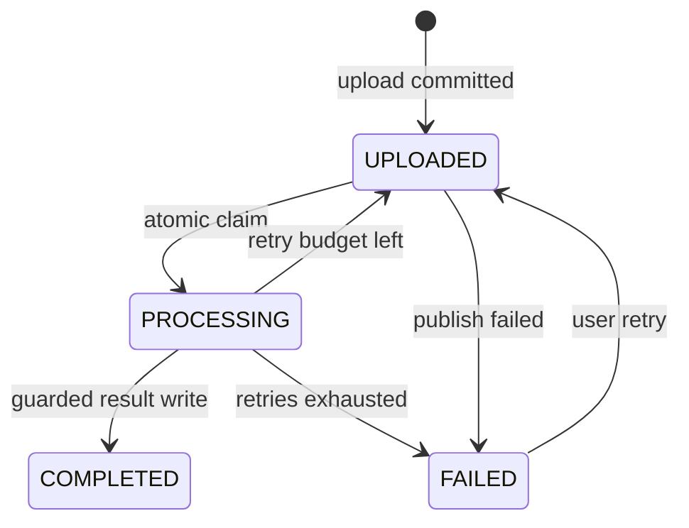

# Architecture

Spring Boot 4 monolith (Java 21): controllers -> services -> JPA repositories ->
PostgreSQL; Redis for idempotency, rate limits, lockout and cache; S3-compatible storage; Brevo/Gemini over HTTP; STOMP
WebSocket for job progress. Auth is JWT-in-HttpOnly-cookie for every caller; Google
sign-in is a provisioning source into the same `users` table, not a second auth
system (see `docs/AUTHENTICATION.md`).

## Contents

- [Modules](#modules)
- [Request lifecycle](#request-lifecycle)
- [Data model](#data-model)
- [Cross-cutting](#cross-cutting)

## Modules

| Package | Owns |
|---|---|
| `controller` | `AuthController` (register/login/refresh/logout/tokens + `GET /providers`), `ProfileController`, `DocumentController` (+ `DocumentWebSocketController`), `HealthController`, `SubscriptionController`. |
| `service` | `AuthService` (incl. `issueTokens`, the shared mint point), `OAuthAccountProvisioner` (find/link/create), `ProfileService`, document + analysis pipeline (`AiAnalysisService` over `GeminiService`/`AnthropicAiProvider`), `EmailService` (Brevo), `ImageService`, `StorageService` (selects `local` / `s3` / `supabase` alias via `S3StorageService`), `RefreshTokenRevocationService`, queue (`AsyncJobQueue` / `RabbitMqJobQueue`). |
| `security` | `JwtAuthenticationFilter` (per-request cookie auth), `GoogleOAuth2UserService` / `GoogleOidcUserService` (verified-email gate for OAuth2 and OIDC), `OAuth2LoginSuccessHandler` / `OAuth2LoginFailureHandler` (cookies+redirect / reason vocabulary), `CookieUtil`, `TokenGenerationUtil`. `SecurityConfig` wires JWT + `oauth2Login` and the public matchers. |
| `entity` / `repository` | `User` (+ `AuthProvider`: `LOCAL`/`GOOGLE`), `RefreshToken` (single-use rotation), documents, health metrics, verification/reset tokens, profiles, subscriptions/credits/audit. |
| `exception` | `GlobalExceptionHandler` error shape; `AccountLinkingException` (409 on sub-mismatch). |
| `config` | CORS, Jackson, async/scheduling, WebSocket, storage/queue conditionals. `PasswordConfig` holds the `PasswordEncoder` bean alone so `SecurityConfig` -> OAuth handlers -> `AuthService` -> encoder never forms a cycle. |

### Layer and dependency view

> **Cycle break:** `DocumentService → JobQueue → Worker → DocumentService` is a
> constructor cycle. Both queue implementations inject the worker via Spring's
> `ObjectProvider<DocumentProcessingService>` so it resolves lazily at enqueue time.

## Request lifecycle

Analysis uploads additionally emit STOMP progress on `/ws` while the job runs
on RabbitMQ by default (`app.queue.type=async` switches to the in-process fallback).

Email never performs I/O inside the request transaction. `AuthService` and
`ProfileService` write an `email_outbox` row with the same commit as the token/password
change; `EmailOutboxPublisher` claims it with a conditional UPDATE and hands it to
RabbitMQ. The consumer reloads the row, calls Brevo, and sets `SENT` only through another
conditional UPDATE, so redeliveries cannot send twice. Failures return the row to
`PENDING` up to `app.email.max-attempts`, then mark it `FAILED`.

## Data model

`users` carries `provider` (`LOCAL` default backfill), nullable `provider_subject`
(Google `sub`), nullable `password` (NULL = Google-only until a reset adds one),
and `token_version` for server-side session invalidation. The unique index
`(provider, provider_subject)` is NULL-safe, so unlinked `LOCAL` rows never
collide while each Google identity maps to one row.

### Document state transitions

Migrations `V1`-`V10` own the tables and indexes listed above; `V12` adds the
payment-transaction ledger (PENDING-first, idempotent via provider reference),
`V13` drops two decorative profile columns, `V14` adds CHECK constraints, `V15`
adds JPA `@Version` columns plus unique ledger indexes, `V16` adds the
`refresh_tokens` rotation table, `V17` adds `documents.version`, `V18`
renames the payment amount column to USD cents, `V19` tracks whether the
source upload was removed after analysis, and `V20` adds the email outbox.

## Cross-cutting

- **Config**: `application.properties` (local, plain values) <- overridden by
  `application-prod.properties` (Render env-var mapping) <- `application-test.properties`
  (self-contained H2, never reads the other two).
- **Migrations**: Flyway `V1`-`V20`, `validate` mode everywhere - schema changes
  ship as versioned SQL, never Hibernate DDL.
- **Observability**: Actuator health/info/prometheus; `HealthCheckService` aggregates
  db/redis/storage probes for Render.
- **Tests**: `@SpringBootTest` + MockMvc on H2 (deterministic - in-memory DB,
  injected `Clock`, no network/sleeps); the OAuth suite asserts our rules without
  network. JaCoCo produces a coverage report; the `check` gate is intentionally
  disabled until coverage rises (see `pom.xml`).
