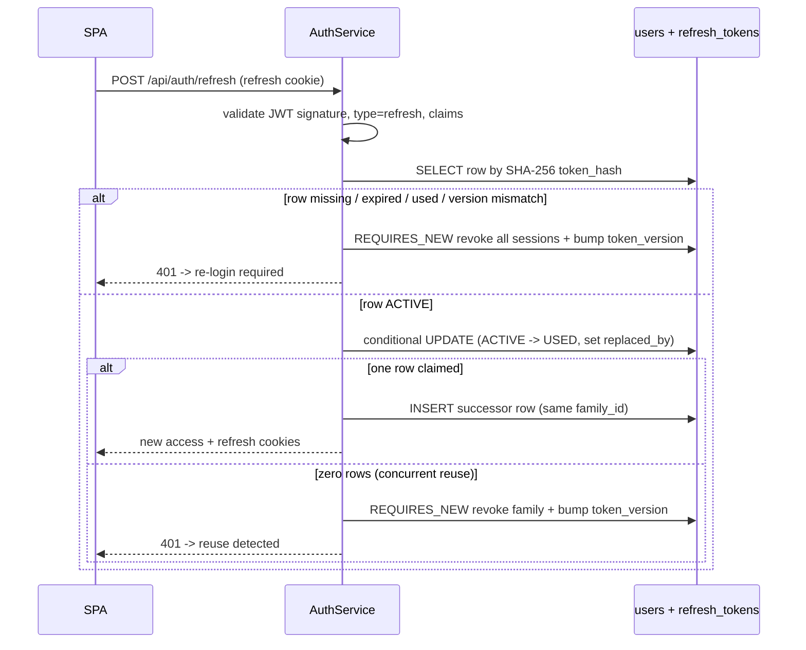
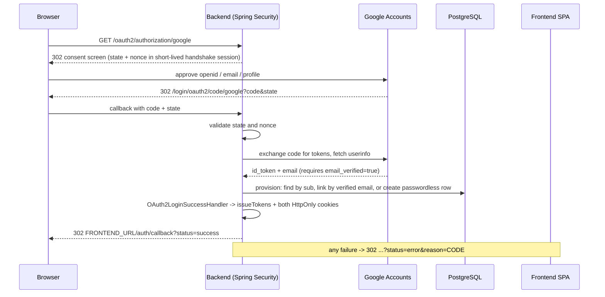

# Authentication

This backend has two ways to open the same session: password login and Google sign-in.
Both end in the same pair of HttpOnly JWT cookies, so nothing downstream of the
cookie jar knows or cares which one was used.

## Contents

- [Password flow](#password-flow)
  - [Refresh rotation and replay detection](#refresh-rotation-and-replay-detection)
- [Google sign-in flow](#google-sign-in-flow)
- [Cookies and CSRF](#cookies-and-csrf)
- [Frontend contract (`/auth/callback`)](#frontend-contract-authcallback)
- [Account linking rules](#account-linking-rules)
- [Security rules](#security-rules)
- [Related files](#related-files)

## Password flow

1. `POST /api/auth/register` creates a `LOCAL` user with `emailVerified=false` and
   sends a Brevo verification link (`FRONTEND_URL` from `application.properties`
   locally, Render env var in prod).
2. `GET /api/auth/verify-email?token=...` flips the flag.
3. `POST /api/auth/login` checks the flag, then the bcrypt hash, then mints
   access (15 min) + refresh (7 days) JWTs into HttpOnly cookies via
   `AuthService.generateTokenResponse` (shared with OAuth through `issueTokens`).
4. `POST /api/auth/refresh` presents a refresh JWT whose SHA-256 hash is checked
   against the `refresh_tokens` table with a single conditional `UPDATE`. Only
   one concurrent caller can claim it; presenting a used/revoked token revokes
   the entire token family and bumps `users.token_version`. Both access and
   refresh JWTs carry that version, so the filter rejects stale tokens.
5. `POST /api/auth/logout` clears both cookies and revokes the presented token,
   every refresh token for the user, and all currently issued access tokens.
6. `POST /api/auth/forgot-password` / `POST /api/auth/reset-password` add a password
   to any account - including a Google-only one, which is how a Google user
   gains password login later.

A `LOCAL` row whose password is missing is rejected at login with a message
telling the user to use Google sign-in or reset their password - bcrypt would
otherwise just say invalid credentials, which is not actionable.

### Refresh rotation and replay detection

Every API request then runs `TokenSessionValidator`: it compares the
`tokenVersion` claim with `users.token_version` and requires `status = ACTIVE`.
WebSocket `CONNECT` frames go through the same validator, so a logged-out user
cannot keep streaming progress over an old signed token.

## Google sign-in flow

Spring Security owns the OAuth plumbing; we only supply what happens before
(provisioning) and after (cookies + redirect).

`SessionCreationPolicy.STATELESS` is NOT contradicted by the handshake session:
STATELESS only means Security never restores a SecurityContext from the
session, and the JWT cookie filter still authenticates every API call. No
session is read after the handshake completes.

## Cookies and CSRF

- Access + refresh JWTs live in HttpOnly, SameSite=Lax cookies (`CookieUtil`);
  Secure is switched on when the CORS origins are https (prod).
- The SPA reads `GET /api/auth/csrf` for the CSRF token and sends state-changing
  requests with credentials included.
- OAuth success sets the exact same cookies as password login, so the JWT
  filter treats both sessions identically.

## Frontend contract (`/auth/callback`)

The SPA owns one route, `/auth/callback`, that completes the handshake:

- Before login it calls `GET /api/auth/providers` -> `{"google": true/false}`.
  When false, hide the Continue with Google button (local dev without
  credentials, or prod before the Render env vars are set).
- The button is a plain link to `<API>/oauth2/authorization/google`
  (top-level navigation, NOT fetch/XHR - the handshake is redirects).
- After Google, the browser lands on:
  - success: `/auth/callback?status=success` -> fetch the profile
    (`GET /api/profile`) to confirm the cookies, then route into the app.
  - error: `/auth/callback?status=error&reason=<code>` -> render a message:

    | reason | meaning |
    |---|---|
    | `access_denied` | user cancelled on the Google screen |
    | `link_conflict` | that Google account is tied to a different local user; sign in with the original method |
    | `email_unverified` | Google did not verify the email; verify it in the Google account first |
    | `state_mismatch` | stale/restarted handshake (tab left open, different browser); try again |
    | `client_not_configured` | backend has no Google credentials; hide the button until configured |
    | `error` | anything else; check the backend log |

The `reason` vocabulary is fixed server-side: exception text is logged only
and never reflected into the URL (no open redirect, no injected markup).

## Account linking rules

(`OAuthAccountProvisioner`: find-or-create / link / create-passwordless)

1. **Returning OAuth user** - `users` row already carries this Google `sub`:
   touch `lastLoginAt` and reuse it.
2. **Linking** - no linked row, but the Google-verified email belongs to a
   `LOCAL` account: attach the Google identity, flip `provider` to `GOOGLE`,
   set `emailVerified=true` (Google vouched for it), keep the password so both
   login methods work.
3. **New account** - create a passwordless row (`password=NULL`,
   `provider=GOOGLE`, `emailVerified=true`) seeded with the names Google
   returned; username is derived from the email local-part with `-1`, `-2`, ...
   dedup and a random-suffix fallback on races.

Deliberate refusal: a row already linked to a DIFFERENT Google `sub` is never
re-pointed (Google guarantees one `sub` per account, so a mismatch means
aliasing, a compromised recovery address, or a bug). Raises
`AccountLinkingException` -> HTTP 409.

## Security rules

- Unverified Google emails are rejected before any row is touched (linking keys
  off the email, so an unvouched address must never attach to an account).
- Password login against a passwordless row is rejected with a use-Google message
  (not invalid credentials).
- Password change on a passwordless row is rejected (nothing to verify against);
  the owner adds a password via forgot-password instead.
- OAuth sessions are byte-identical to password sessions (same issuer, same
  version check), so logout-all / token-version revocation covers both.

## Related files

- `config/SecurityConfig.java` - JWT filter + `oauth2Login` wiring, public matchers
  for `/api/auth/providers`, `/oauth2/**`, `/login/oauth2/**`.
- `security/GoogleOAuth2UserService.java` - verified-email gate, delegates to provisioner.
- `service/OAuthAccountProvisioner.java` - the three linking outcomes.
- `security/OAuth2LoginSuccessHandler.java` / `OAuth2LoginFailureHandler.java` -
  cookies + redirect / fixed reason vocabulary.
- `service/AuthService.java#issueTokens` - shared mint point for all sign-in paths.
- `entity/User.java` + `entity/AuthProvider.java` - `provider` / `providerSubject`.
- `db/migration/V11__Add_Google_OAuth_Support.sql` - the schema change.
- `controller/AuthController.java#providers` - the capability flag.
- `application.properties` (local Google placeholder) /
  `application-prod.properties` (Render `GOOGLE_CLIENT_ID` / `GOOGLE_CLIENT_SECRET`).
